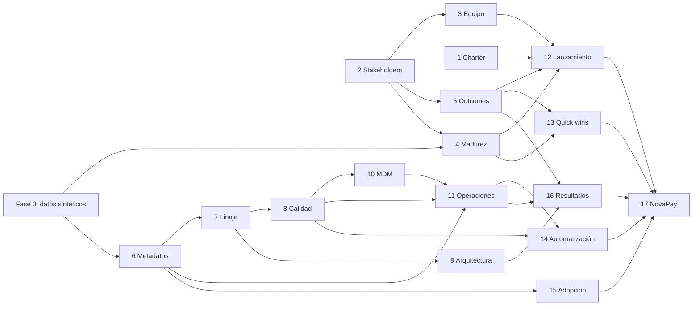

# Plan maestro: Data Governance Lab

Este proyecto convierte *Data Governance Handbook* (Wendy S. Batchelder, Packt 2024) en 17 microproyectos ordenados, uno por capítulo. Todos se aplican a la misma empresa ficticia, para que cada capítulo construya sobre lo que dejaron los anteriores.

## 1. Visión y método de trabajo

- **Un capítulo, un microproyecto, un commit o PR.** Se avanza en orden y no se empieza un capítulo hasta cerrar el anterior, salvo que no tengan dependencias entre sí.
- **Enfoque híbrido.** Los capítulos técnicos (6–11 y 14–15) producen código que trabaja sobre datos sintéticos. Los capítulos de gestión (1–5, 12, 13 y 16) producen entregables documentales, como charters, mapas, scorecards o memos, que se generan o validan con código a partir de entradas en YAML. Así siguen siendo reproducibles y versionables.
- **Estructura fija por capítulo** (`chapters/chNN_<slug>/`):
  - `README.md`: objetivo, conceptos del libro, entregables, decisiones y conclusiones.
  - `inputs/`: supuestos y configuración (YAML/CSV), editables a mano.
  - `run.py`: punto de entrada único (`uv run python -m chapters.chNN_<slug>.run`). Cada capítulo es un paquete de Python, así que sus módulos se importan desde los tests sin chocar con los de otros capítulos.
  - `outputs/`: artefactos generados. No se versionan porque se regeneran con `run.py`.
  - `tests/`: tests con pytest.
- **Código compartido** en `src/dglab/`. Si algo se usa en dos capítulos, se mueve aquí.
- **Definición de hecho de cada capítulo:**
  1. `run.py` genera todos los entregables sin errores.
  2. `uv run pytest` y `uv run ruff check .` pasan en verde.
  3. El README del capítulo explica las decisiones y conclusiones, enlazadas con los conceptos del libro.
  4. La checklist de la sección 6 está actualizada.
  5. El recorrido paso a paso del [README raíz](README.md) incluye el paso del capítulo: comando, dependencias, qué mirar y qué probar.

**Stack:** Python 3.12 (gestionado con uv), DuckDB, pandas, pandera, Faker, pydantic, PyYAML, rapidfuzz, sqlglot, networkx, matplotlib, jinja2, typer, rich, pytest y ruff. Todo se ejecuta en local, sin servicios externos.

## 2. La empresa ficticia: NovaMercado

**NovaMercado** es un retail omnicanal con tiendas físicas, e-commerce y app móvil. Su filial financiera **NovaPay** (tarjeta de crédito y monedero digital) es una entidad regulada y protagoniza el capítulo 17.

| Dominio | Unidad responsable | Entidades principales |
|---|---|---|
| customer | Marketing y CRM | clientes, hogares, consentimientos |
| product | Comercial | productos, categorías, precios |
| supplier | Compras | proveedores, contactos |
| sales | Ventas | pedidos, líneas de pedido, devoluciones |
| store | Operaciones | tiendas, regiones |
| finance | Finanzas | facturas, centros de coste |

**Sistemas de origen simulados:** `pos` (punto de venta), `ecom` (e-commerce), `crm` (CRM y fidelización) y `erp` (compras, inventario y finanzas).

**Defectos de calidad sembrados a propósito.** Se controlan con la semilla, así que siempre son los mismos:
- El mismo cliente aparece en CRM, ecom y POS con variaciones de nombre, email o teléfono (capítulo 10).
- Hay nulos en campos obligatorios, formatos de fecha y teléfono inconsistentes, códigos postales inválidos y precios negativos (capítulo 8).
- Hay productos sin categoría y proveedores sin contacto, que generan problemas de ownership y de completitud (capítulos 6 y 13).
- Hay columnas con PII sin clasificar (capítulo 6).

## 3. Fase 0: base compartida

Esta fase es necesaria antes del capítulo 4 y de todos los técnicos.

| Componente | Ubicación | Descripción |
|---|---|---|
| Generador sintético | `src/dglab/synthetic/` | Genera con Faker (locale `es_ES`) y semilla fija los CSV por sistema de origen en `data/raw/`, con los defectos sembrados y un solucionario en `data/raw/_truth/` |
| Carga al warehouse | `src/dglab/warehouse/` | Carga en `data/warehouse/novamercado.duckdb` con esquemas `raw`, `staging` y `curated` |
| Reporting | `src/dglab/reporting.py` | Helpers jinja2 para generar Markdown y HTML, y para guardar figuras |
| CLI | `dglab` (typer) | `dglab build`, `dglab generate`, `dglab load` y `dglab reset` |

**Criterios de aceptación:** dos ejecuciones con la misma semilla producen datos idénticos; las tasas de defectos sembrados se pueden configurar y se comprueban con tests.

## 4. Microproyectos por capítulo

### Parte 1: Diseñar el camino hacia datos confiables

| # | Capítulo | Microproyecto | Entregables | Criterio de aceptación |
|---|---|---|---|---|
| 1 | What Is Data Governance? | Charter del programa y caso de negocio | Data equity (activos − pasivos); caso de negocio con 3 opciones de timeline (VAN, ROI, payback); charter con why statement, misiones y decisión de lanzar o esperar; política de 10 secciones; EDG Scorecard | Solo cuentan los beneficios validados por el negocio; la política tiene las 10 secciones; el scorecard se deriva del estado de cada dominio |
| 2 | How to Build a Coalition of Advocates | Mapa de stakeholders y sponsor | Registro de stakeholders con escucha en 5 direcciones, mapa objetivos → soluciones → resultados, matriz influencia/interés, scoring de sponsors con caso de negocio por tracks, señales del comité y plan de comunicación | El CIO nunca es sponsor; se detectan las *vanity metrics*; las señales del comité salen del registro de reuniones |
| 3 | Building a High-Performing Team | Diseño organizativo | Resultados priorizados, selector de modelo por reglas (federado / hub and spoke / centralizado), organigrama y plan de contratación, roles por dominio, RACI, cartas y calendario de foros, portfolio, IA y brechas de habilidades | Cada actividad de la RACI tiene exactamente un *Accountable*; el coste del equipo se contrasta con el caso de negocio del capítulo 1 |
| 4 | Baseline Your Organization | Evaluación de madurez | Modelo propio (6 niveles, 8 dimensiones), participantes del capítulo 3, respuestas simuladas con sesgo de autoevaluación, evidencia del warehouse, informe agregado y desagregado, plan con métricas de línea base | Se cubren los 10 pasos del libro; se detectan el sesgo de autoevaluación y las puntuaciones que la evidencia no respalda |

### Parte 2: Las capacidades de gobierno de datos en profundidad

| # | Capítulo | Microproyecto | Entregables | Criterio de aceptación |
|---|---|---|---|---|
| 5 | Defining Success and Aligning on Outcomes | Árbol de resultados | Marco resultado → capacidades → entregables → resultados de datos con los 8 pasos; valor desde la data equity del capítulo 1; informe de progreso, roadmap, barreras y QBR sobre el mapa del capítulo 2 | La validación falla con estructura rota o métricas sin responsable; los resultados de datos se miden en el warehouse |
| 6 | Metadata Management | Glosario y catálogo | Glosario de negocio, catálogo extraído de DuckDB, clasificación de PII por nombre y contenido, estándar de metadatos por dominio, publicación en el warehouse (comentarios y esquema `meta`) y CLI de búsqueda | El 100 % de las tablas curated queda documentado y clasificado; el avance se mide en los capítulos 4 y 5 |
| 7 | Technical Metadata and Data Lineage | Linaje a nivel de columna | SQL del warehouse → grafo de columnas (sqlglot + networkx) con filtros y claves de unión, análisis de impacto, validación de la narrativa del responsable, hallazgos, madurez y ROI; publicación en `meta.lineage_edges` | Dada una columna raw se listan todas sus dependientes, incluidas las que dependen de ella por un filtro |
| 8 | Data Quality | Calidad y certificación | Perfilado por forma, 17 reglas con pandera por dimensión y severidad, scorecard, incidencias y disposiciones, certificación apoyada en linaje, documentación y steward, detección frente al solucionario y valor | Se detecta el 100 % de los defectos sembrados; solo se certifica lo que cumple, incluidas sus fuentes |
| 9 | Data Architecture | Principios y linter | As-is / to-be (Mermaid) con almacenes y flujos, principios, 10 estándares comprobados sobre el warehouse y sobre el SQL, revisión SDLC por CLI, programa, roadmap y medidas de éxito | El linter detecta nomenclatura, capas, tipos, claves, documentación y PII; la propuesta de ejemplo se rechaza |
| 10 | Primary Data Management | Golden record de cliente | Matching difuso (rapidfuzz), reglas de supervivencia y trust logic, jerarquía de hogares, datos de referencia | Se resuelve como mínimo el 90 % de los duplicados sembrados, con trazabilidad al origen |
| 11 | Data Operations | Operaciones con SLAs | Mini orquestador de los pipelines de los capítulos 6–10, log de ejecuciones, SLAs, registro de incidentes y dashboard | Se detectan y registran las violaciones de SLA |

### Parte 3: Generar confianza con entregas basadas en valor

| # | Capítulo | Microproyecto | Entregables | Criterio de aceptación |
|---|---|---|---|---|
| 12 | Launch Powerfully | Kit de lanzamiento | Scoring de readiness, narrativa as-is vs to-be, memo narrativo generado con jinja2 a partir de los capítulos 1–5 | El memo se regenera solo cuando cambian los inputs |
| 13 | Delivering Quick Wins with Impact | Backlog priorizado | Matriz valor/esfuerzo, clasificación corto/largo plazo, registro de data ownership, plantillas de política, estándar y procedimiento | Cada quick win está ligado a un outcome del capítulo 5 |
| 14 | Data Automation | Automatizar un proceso manual | El proceso manual y su versión automatizada, enriquecimiento de terceros simulado, ROI antes y después (6 pasos) | El ROI se calcula con tiempos medidos, no supuestos |
| 15 | Adoption That Drives Business Success | Métricas de adopción | Logs de uso sintéticos → KPIs (usuarios activos, retención, cobertura), coste de la baja adopción, roadmap | Los KPIs se calculan por segmento y el roadmap ataca las barreras detectadas |
| 16 | Delivering Trusted Results | Revisión de capacidades | Reporte HTML consolidado de los capítulos 6–11 y plantilla para comunicar desvíos | El reporte compara los compromisos del capítulo 5 con los resultados reales |

### Parte 4: Caso de estudio

| # | Capítulo | Microproyecto | Entregables | Criterio de aceptación |
|---|---|---|---|---|
| 17 | Case Study – Financial Institution | NovaPay de punta a punta | Datos de NovaPay (cuentas, transacciones, KYC), ejecución de los microproyectos, mensajes al comité ejecutivo y al regulador, resultados | Un solo comando ejecuta el caso completo |

## 5. Dependencias y orden recomendado

Orden de trabajo: **Capítulos 1 → 2 → 3 → Fase 0 → 4 → 5 → … → 17**. La Fase 0 va justo antes del capítulo 4, que es el primero que necesita datos.

## 6. Seguimiento

| Paso | Estado |
|---|---|
| Setup: entorno uv, estructura y plan | ✅ hecho |
| Fase 0: datos sintéticos y warehouse | ✅ hecho ([docs/datos_sinteticos.md](docs/datos_sinteticos.md)) |
| Cap. 1: Charter y caso de negocio | ✅ hecho |
| Cap. 2: Stakeholders y sponsor | ✅ hecho |
| Cap. 3: Diseño organizativo | ✅ hecho |
| Cap. 4: Evaluación de madurez | ✅ hecho |
| Cap. 5: Árbol de resultados | ✅ hecho |
| Cap. 6: Glosario y catálogo | ✅ hecho |
| Cap. 7: Linaje | ✅ hecho |
| Cap. 8: Calidad y certificación | ✅ hecho |
| Cap. 9: Arquitectura | ✅ hecho |
| Cap. 10: Golden record | ⬜ pendiente |
| Cap. 11: Operaciones | ⬜ pendiente |
| Cap. 12: Kit de lanzamiento | ⬜ pendiente |
| Cap. 13: Quick wins | ⬜ pendiente |
| Cap. 14: Automatización | ⬜ pendiente |
| Cap. 15: Adopción | ⬜ pendiente |
| Cap. 16: Revisión de capacidades | ⬜ pendiente |
| Cap. 17: Caso NovaPay | ⬜ pendiente |
